  
  
  
  
  

### Hi, I'm Harshita 👋

I'm a CS graduate (B.Tech, UIET, Kurukshetra University), passionate about developing things, who builds **machine-learning and data systems and then tries hard to break them**. My projects range from private learning across hospitals, to routing that survives attackers in disaster networks, to data checks that name the cause of a fault, to a physics check of a space-debris spacecraft I designed myself. Every result comes with a baseline, an interval and a list of limits, including the ones that did not work.

**Focus:** privacy-preserving ML · data quality and drift · networks and simulation · scientific visualisation  
**Now:** Business Development Manager at reeducate.ai, leading product and outreach for Coding Pro

## ✦ Projects

<table>
<tr>
<td width="50%"><a href="https://github.com/hersheyharshi/espira"></a></td>
<td width="50%"><a href="https://github.com/hersheyharshi/GhostMesh"></a></td>
</tr>
<tr>
<td align="center"><a href="https://hersheyharshi.github.io/espira/film.html"><b>▶ Watch the mission film</b></a> · <a href="https://hersheyharshi.github.io/espira/">Website</a> · <a href="https://github.com/hersheyharshi/espira">Code</a></td>
<td align="center"><a href="https://hersheyharshi.github.io/GhostMesh/"><b>▶ Try the live demo</b></a> · <a href="https://github.com/hersheyharshi/GhostMesh">Code</a></td>
</tr>
<tr>
<td width="50%"><a href="https://github.com/hersheyharshi/driftguard"></a></td>
<td width="50%"><a href="https://github.com/hersheyharshi/federated-feature-store"></a></td>
</tr>
<tr>
<td align="center"><a href="https://github.com/hersheyharshi/driftguard"><b>Code and benchmark</b></a></td>
<td align="center"><a href="https://github.com/hersheyharshi/federated-feature-store"><b>Code</b></a> · <a href="https://doi.org/10.5281/zenodo.24096856">DOI 10.5281/zenodo.24096856</a></td>
</tr>
</table>

### 🛰️ Spotlight: ESPIRA

<a href="https://hersheyharshi.github.io/espira/film.html">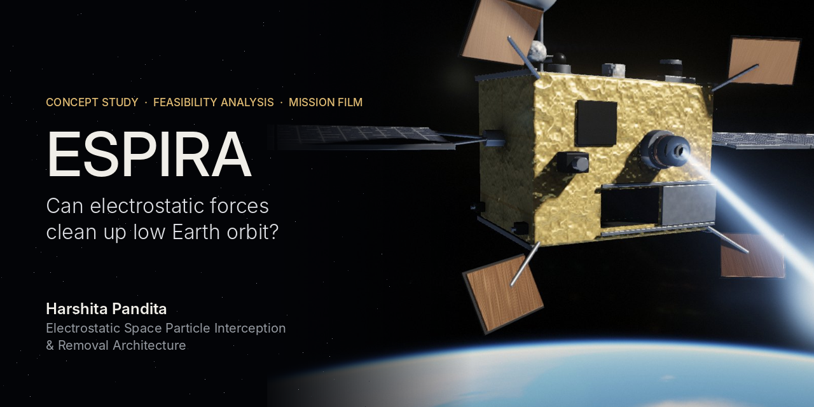</a>

A multi-mechanism probe for clearing space debris: a charged beam for 1 to 10 cm fragments, a net arm for objects over 10 cm, and a swarm for the rest. I built the concept, then a Python plasma model to test it, and the physics said no: holding ±20 kV in low orbit needs about 19 to 24 kW, against 1.4 kW available. The write-up explains why, and proposes the designs that do work (a GEO electrostatic tractor and LEO electrodynamic tethers). The 80-second mission film runs in your browser, rendered in raw WebGL2.

<b>More on each project</b>

 

**GhostMesh.** Trust-aware routing for mesh networks after a disaster, when some relays may be malicious. Compared against OLSR-ETX with 20% malicious relays, delivery rose from 47% to 58% (p = 2×10⁻⁶) and packets lost to attackers fell by 66%. A live dashboard streams the simulation over WebSocket.

**DriftGuard.** Data checks that do not stop at "something changed". Across a benchmark of injected faults (unit changes, clock shifts, column swaps, replayed batches) it caught 100 of 100 with the correct cause, at a 1.2% false-alarm rate, and its repairs prevented 94% of the damage to a downstream forecast.

**Federated feature store.** Co-authored with [Pranjal Tomar](https://github.com/Pranjaltomar07). Can four hospitals share one heart-disease model without sharing a single patient record? A shared feature store added 8.4 points of accuracy, and strong privacy (ε = 1) cost only 1.2 points. My track: the federated training loop, the privacy dial and the privacy guarantee.

<b>Deep dive: the federated research, card by card</b>

 

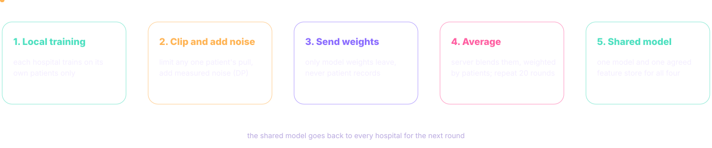

<table>
<tr>
<td width="50%"><a href="https://github.com/hersheyharshi/federated-feature-store"></a></td>
<td width="50%"><a href="https://github.com/hersheyharshi/federated-feature-store"></a></td>
</tr>
<tr>
<td width="50%"><a href="https://github.com/hersheyharshi/federated-feature-store"></a></td>
<td width="50%"></td>
</tr>
<tr>
<td width="50%"><a href="https://github.com/hersheyharshi/federated-feature-store"></a></td>
<td width="50%"></td>
</tr>
</table>

Public heart-disease data split by site to behave like separate hospitals; a simulation study, not clinically validated. Ten seeds, so intervals reflect training and split randomness, not new patients.

## ✦ Experience

**Education:** B.Tech, Computer Science and Engineering, UIET, Kurukshetra University (2022–2026)  
**Leadership:** Google Developer Student Clubs, organiser and ambassador co-lead (2024–25)

## ✦ Toolbox

**Also built:** Smart Beauty Recommender · AI PathFinder (reinforcement-learning agent, 85% success) · Kaggle Orbit Wars entry

## ✦ How I work
- **Baselines first.** A result only counts if it beats the simplest sensible alternative.
- **Report the failures.** ESPIRA failed its own physics check, and the private feature store did not work; both write-ups say so.
- **Reproducible.** Open code, tests and a DOI so others can check it.
- I design, code and implement my work, use GenAI tools as an assistant, and test and validate the results myself.

## ✦ Let's build something

I'm a CS graduate who loves building things that work in the real world, and I'm open to **MSc and MTech research collaborations**, **project collaborations**, and **jobs and internships** in machine learning, data and software development. If you have an idea, a dataset or a role, [say hello](mailto:panditaharshita75@gmail.com) or find me on [LinkedIn](https://www.linkedin.com/in/harshita-pandita-4b277218b).

✦ Open to MSc / MTech research · project collaborations · jobs and internships ✦

